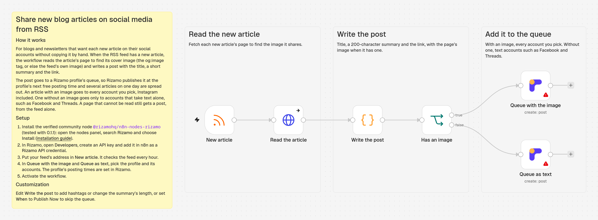
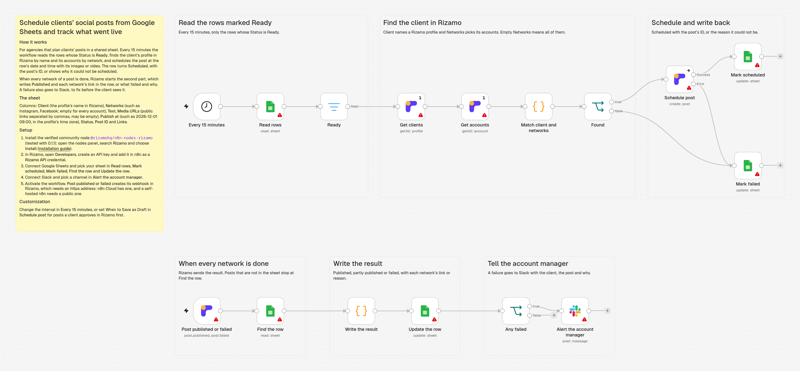
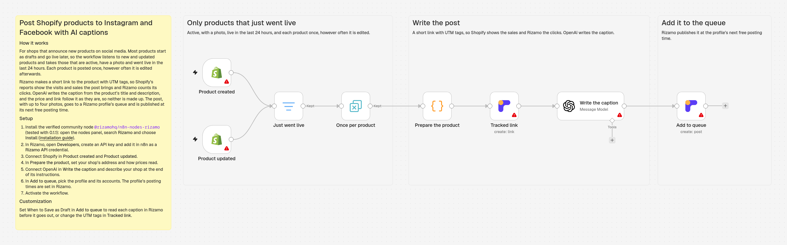
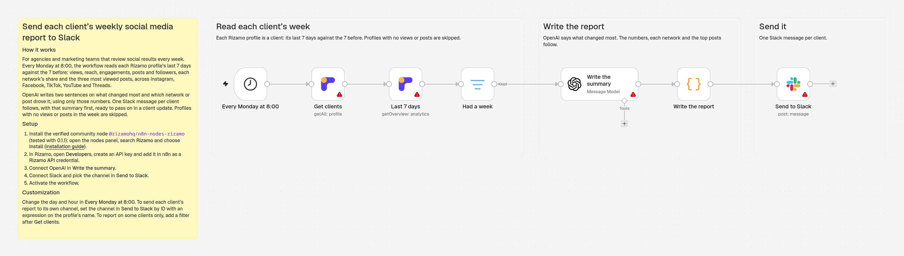
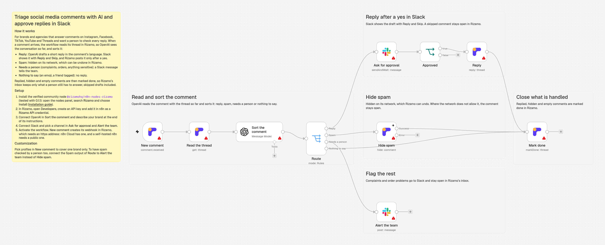

# Templates

Workflows for [n8n.io/workflows](https://n8n.io/workflows) that use the Rizamo node. Import one in n8n with **Import from File**, then follow its sticky note.

## Share new blog articles on social media from RSS with Rizamo

`blog-rss-to-social-queue.json`

Each new article in your blog's RSS feed becomes a post in your Rizamo queue, with the image the article shares. Articles with an image go to every account you choose, Instagram included; the others go to text accounts such as Facebook and Threads.

## Schedule clients' social posts from Google Sheets and track what went live with Rizamo

`agency-google-sheets-to-scheduled-posts.json`

For agencies: each row of a Google Sheet with Status Ready becomes a scheduled post on the client's Rizamo profile, found by its name, on the networks the row names, with its images or video. When every network is done, the row shows Published with each network's link, or what failed and why, and a failure goes to Slack.

## Post Shopify products to Instagram and Facebook with AI captions and tracked links via Rizamo

`shopify-new-product-to-social.json`

When a Shopify product goes live, whether it was created active or published later from a draft, Rizamo adds a post with up to four photos to your profile's queue, once per product. OpenAI writes the caption, and the price and a Rizamo short link with UTM tags follow it, so Shopify shows the sales the post brings.

## Send each client's weekly social media report to Slack with an AI summary using Rizamo

`weekly-social-report-to-slack.json`

Every Monday at 8:00, one Slack message per Rizamo profile: two sentences from OpenAI on what changed most, then views, reach, engagements, posts and followers against the week before, each network's numbers and the week's top three posts.

## Triage social media comments with AI, hide spam and approve replies in Slack with Rizamo

`ai-comment-replies-approved-in-slack.json`

Each new comment on Instagram, Facebook, TikTok, YouTube or Threads is read with its thread and sorted by OpenAI. Replies are drafted and posted only after someone chooses Reply in Slack, spam is hidden, complaints go to Slack, and what is handled is marked done in Rizamo's inbox.
